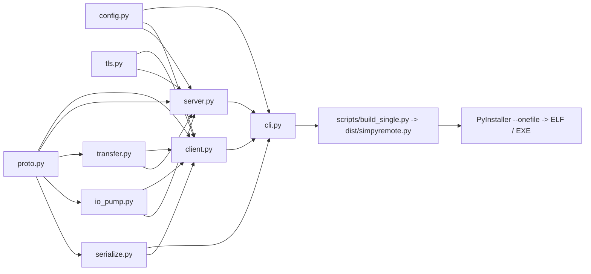
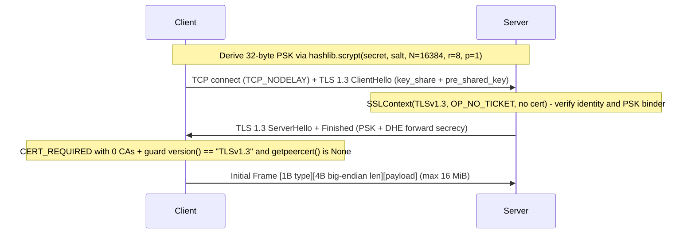
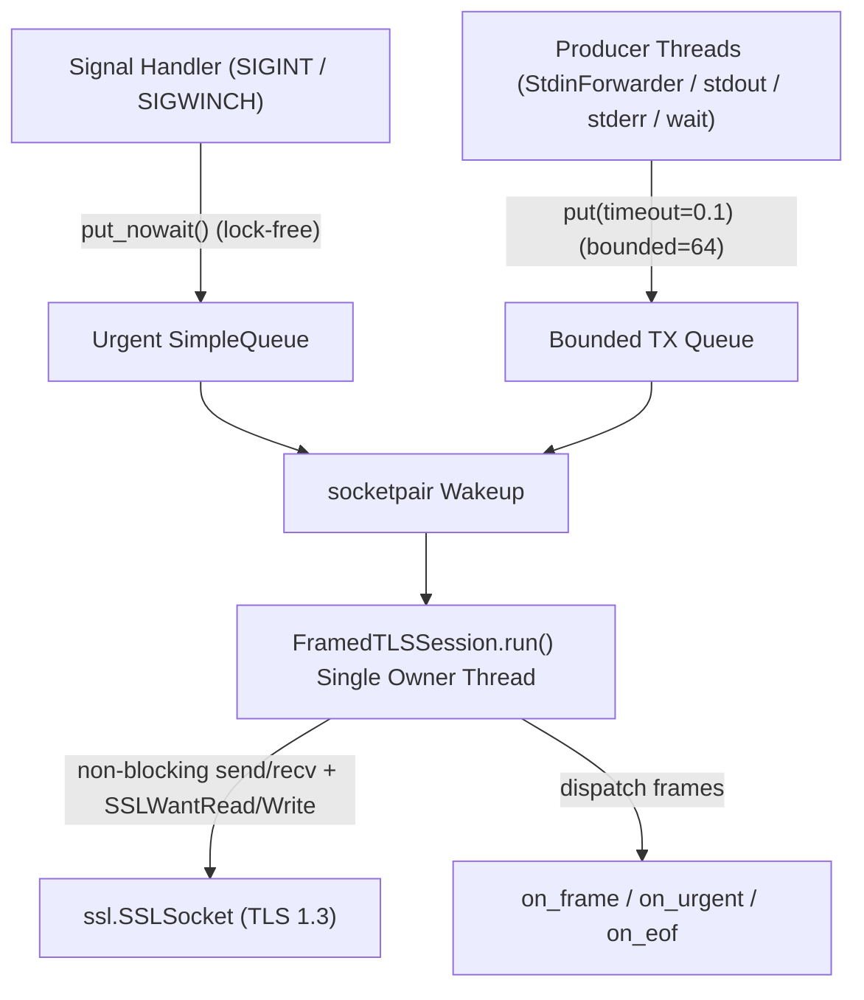
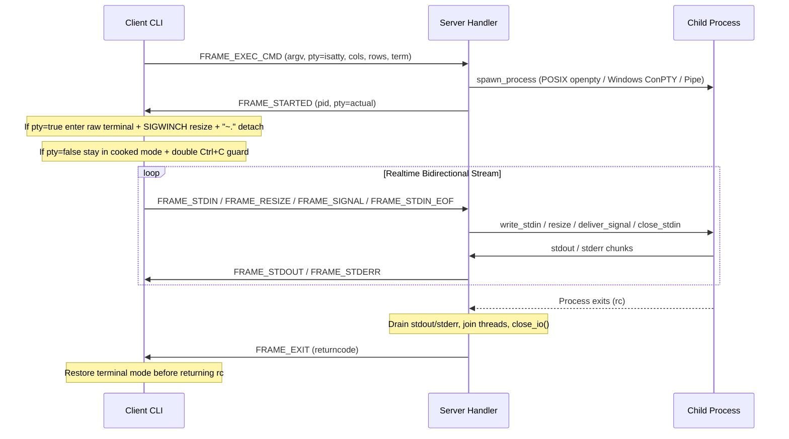
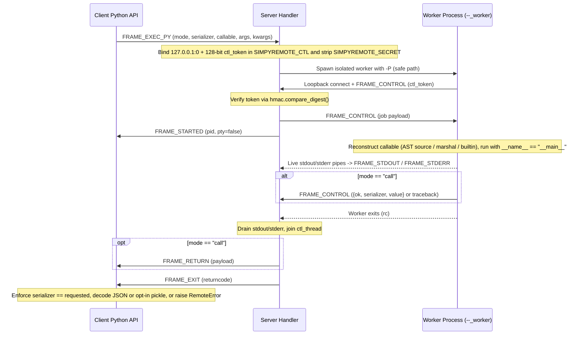
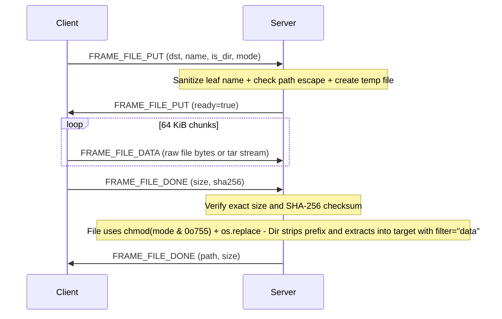

# simpyremote Architecture

This document describes the internal architecture, module layout, wire protocol, concurrency model, and security boundaries of `simpyremote`.

## 1. Module DAG & Distribution Pipeline

`src/simpyremote` is structured as a strict directed acyclic graph (DAG) with zero circular imports and zero external runtime dependencies. Because the dependency graph is acyclic, `scripts/build_single.py` can statically parse each module's AST in topological order, hoist and deduplicate imports, verify no top-level symbol collisions exist, and emit a single self-contained `dist/simpyremote.py` script that PyInstaller can trace without dynamic `zipimport` or `base64`/`exec` loaders.

## 2. Wire Protocol & Mutual-Auth TLS 1.3 PSK

Every session opens a fresh TCP connection upgraded immediately to TLS 1.3 External PSK (`set_psk_client_callback` / `set_psk_server_callback`). No X.509 certificates are loaded or accepted.

### Frame Types

| Hex | Name | Direction | Payload |
| :--- | :--- | :--- | :--- |
| `0x01` | `FRAME_EXEC_CMD` | C -> S | JSON `{argv, cwd, pty, cols, rows, term}` |
| `0x02` | `FRAME_EXEC_PY` | C -> S | JSON serialized callable job (`source`, `code`, or `builtin`) |
| `0x03` | `FRAME_STDIN` | C -> S | Raw stdin bytes |
| `0x04` | `FRAME_STDIN_EOF` | C -> S | Empty (closes remote pipe stdin) |
| `0x05` | `FRAME_STDOUT` | S -> C | Raw stdout bytes (or combined PTY stream) |
| `0x06` | `FRAME_STDERR` | S -> C | Raw stderr bytes (pipe mode only) |
| `0x07` | `FRAME_SIGNAL` | C -> S | UTF-8 signal name (`INT`, `TERM`, `KILL`) |
| `0x08` | `FRAME_EXIT` | S -> C | JSON `{returncode}` |
| `0x09` | `FRAME_ERROR` | S -> C | JSON `{error}` |
| `0x0A` | `FRAME_RETURN` | S -> C | JSON `{ok, serializer, value}` or `{ok: false, exc_type, error, traceback}` |
| `0x0B` | `FRAME_STARTED` | S -> C | JSON `{pid, pty}` |
| `0x0C` | `FRAME_CONTROL` | Local | Loopback worker control channel (token auth, job payload, return payload) |
| `0x0D` | `FRAME_RESIZE` | C -> S | JSON `{cols, rows}` |
| `0x10` | `FRAME_FILE_PUT` | Both | Upload metadata (C -> S) and ready ACK (S -> C) |
| `0x11` | `FRAME_FILE_GET` | Both | Download request (C -> S) and metadata (S -> C) |
| `0x12` | `FRAME_FILE_DATA` | Both | 64 KiB streaming file or tar chunk |
| `0x13` | `FRAME_FILE_DONE` | Both | JSON `{size, sha256}` or `{path, size}` ACK |

## 3. Single-Owner TLS Multiplexer (`FramedTLSSession`)

OpenSSL `SSL*` objects are not safe for concurrent `SSL_read` and `SSL_write` across threads (especially during TLS 1.3 post-handshake messages or alerts), and Python signal handlers cannot safely acquire locks or write to stderr directly.

`FramedTLSSession` solves both constraints by making a single non-blocking `selectors.DefaultSelector` event loop the exclusive owner of `ssl.SSLSocket`:

Key invariants:
- `FRAME_STARTED` is enqueued before spawning server stdout/stderr/wait threads so it is strictly the first frame delivered to the client.
- Server-side incoming `FRAME_STDIN` is written by a dedicated `_stdin_writer_loop` thread fed by a queue capped at `MAX_PENDING_STDIN_BYTES` (4 MiB). A full child stdin pipe cannot block `FRAME_SIGNAL` delivery, and an unread stdin flood cannot exhaust server RAM.
- On client disconnect or detach, `session.close()` unblocks worker threads and `_handle_client` releases its `BoundedSemaphore(64)` slot immediately while the reaper thread still waits for and reaps the child process to avoid zombies.

## 4. Execution Flows

### 4.1 Interactive CLI Session (Auto-PTY vs Pipe)

### 4.2 Stateless Python Execution (`run()` and `call()`)

To keep return values isolated from arbitrary user `print()` output and isolate global state/crashes per call, the server spawns a fresh OS worker process (`python -P ... --_worker` or `<frozen-binary> --_worker`) connected over an authenticated loopback control channel:

## 5. Streaming File & Directory Transfer

Uploads use a 2-step handshake so invalid paths or permissions fail before streaming data. All transfers enforce a `120s` idle socket timeout on the server and verify exact byte count and SHA-256 before committing to the final destination.

## 6. Cross-Platform Primitives Summary

| Capability | Linux / POSIX | Windows |
| :--- | :--- | :--- |
| **PTY allocation** | `pty.openpty()` + `TIOCSWINSZ` + `os.posix_spawnp(setsid=True)` (falls back to `Popen(preexec_fn=...)` when `POSIX_SPAWN_SETSID` is unavailable or `cwd` is set) | `CreatePseudoConsole` (ConPTY via `ctypes`) with sorted UTF-16LE cleaned env block and `STARTF_USESTDHANDLES` (falls back to pipes if unavailable or under Wine) |
| **Local raw terminal** | `termios.tcgetattr` / `tty.setraw` + `SIGWINCH` | `SetConsoleMode` (`ENABLE_WINDOW_INPUT` + `ENABLE_VIRTUAL_TERMINAL_PROCESSING`) + non-blocking `ReadConsoleInputW` (UTF-8 + VT keys + `WINDOW_BUFFER_SIZE_EVENT`) |
| **Stdin forwarding** | `selectors.DefaultSelector` + wakeup `os.pipe()` | `PeekNamedPipe` (pipes), `ReadConsoleInputW` (raw console), `WaitForSingleObject` + `kbhit()` (cooked console), `msvcrt.setmode` restored on exit |
| **Signal delivery** | `start_new_session=True` + `os.killpg()` | Pipe mode: `CREATE_NEW_PROCESS_GROUP` + `CTRL_BREAK_EVENT` (mapped to `KeyboardInterrupt` in `--_worker`); ConPTY: `\x03` to stdin for `INT`, `TerminateProcess` for `TERM`/`KILL` |
| **Default shell** | `$SHELL` or `/bin/sh` | `powershell.exe -NoLogo`, `$COMSPEC`, or `cmd.exe` |
